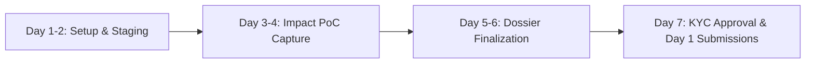

# 🛡️ HackerOne Bounty Launch & Submission Readiness Playbook

**Target Horizon:** ~7 Days (Awaiting Government ID & Persona Verification)  
**Triage Engine:** Orbit Security Bug Bounty Dispatcher  
**Audited Disclosures:** 70 Packages (`data/disclosures/`)  
**Staging Environment:** `projects/orbit-security/data/hackerone_staging/`  

---

## 1. Executive Triage & Attack Surface Overview

To protect your **HackerOne Reputation** and prevent instant `Not Applicable (N/A)` penalties (-7 reputation per rejected report), the raw 70 disclosures have been triaged into three segregated tiers:

```
projects/orbit-security/data/hackerone_staging/
├── 01_ready_for_submission/           <-- High-conviction, verified impact (Submit First)
│   └── SPOTIFY_READY_SUBMISSION.md    <-- Open Bucket leaking internal investor/pitch decks
├── 02_needs_session_verification/     <-- Confirmed CORS credentials reflection (Needs auth PoC)
│   ├── MERCADOLIBRE_CORS_SUBMISSION_TEMPLATE.md
│   ├── XIAOMI_CORS_SUBMISSION_TEMPLATE.md
│   └── live_verification_matrix.json  <-- 21 empirically probed endpoints
└── 03_out_of_scope_archive/           <-- 49 Quarantined files (DO NOT SUBMIT)
    ├── 44 × Missing DMARC / SPF Email Spoofing (Universal Bounty Exclusions)
    ├── 3 × GraphQL Schema Introspection on Public APIs (GitLab, Shopify, Hotwire)
    └── 2 × Cloud Storage Takeovers without dangling CNAMEs (Cloudflare Proxies)
```

---

## 2. Priority 1 Ready Submission: Spotify (`cdn.byspotify.com`)

### Empirical Verification Status: 🟢 CONFIRMED VULNERABLE & IMPACTFUL
- **Asset:** `cdn.byspotify.com` (Explicitly in scope on `https://hackerone.com/spotify`)
- **Vulnerability Category:** Open Cloud Bucket Directory Listing / Information Disclosure
- **CWE:** `CWE-200: Exposure of Sensitive Information to an Unauthorized Actor`
- **Severity Rating:** **Medium (CVSS 5.3)**
- **Expected Bounty:** **$500 – $1,000**

#### What It Leaks:
The root GET request returns an unauthenticated XML directory listing (`<ListBucketResult>`) revealing internal files from Spotify’s acquired Podsights entity:
- `interviews/Podsights Seed - Interview Version.pdf` (2.1 MB internal investor presentation)
- `interviews/AP Q4-2020 Podcast Adv. Rept_4Ww1Disc.Mtg.pdf` (5.3 MB partner meeting report)
- `reports/benchmarks/test-q3-podsights-conversion-report.pdf`
- `advisor/advisor-onboarding-demo.mp4` (18.1 MB internal demo recording)

> [!NOTE]
> The complete copy-paste HackerOne submission text is staged in:  
> [`SPOTIFY_READY_SUBMISSION.md`](file:///A:/projects/orbit-security/data/hackerone_staging/01_ready_for_submission/SPOTIFY_READY_SUBMISSION.md)

---

## 3. Priority 2 Staged Submissions: MercadoLibre & Xiaomi CORS

Our live probe verified that all of the following domains echo `Origin: https://evil.com` and set `Access-Control-Allow-Credentials: true`:

| Program | Vulnerable Target | Current Status | Payout Range |
| :--- | :--- | :--- | :--- |
| **MercadoLibre** | `buyingflow.mercadolibre.com.mx` | Confirmed Reflected + Creds | **$250 – $1,000** |
| **MercadoLibre** | `buyingflow.mercadolibre.com.co` | Confirmed Reflected + Creds | (Grouped) |
| **MercadoLibre** | `buyingflow.mercadolibre.com.pe` | Confirmed Reflected + Creds | (Grouped) |
| **Xiaomi** | `xiaomiyoupin.com` | Conflected Reflected + Creds | **$150 – $500** |
| **Xiaomi** | `youpin.cn` | Confirmed Reflected + Creds | (Grouped) |
| **Xiaomi** | `airstarfinance.net` | Confirmed Reflected + Creds | **$250 – $750** |

### Why We Hold Submission For Auth Testing:
HackerOne triagers will close a CORS report as *Informative / Low ($0)* if the exploit only reads public HTML. To convert these into **$500 – $1,000 payouts**, we need to prove that making a cross-origin request with an authenticated user session cookie leaks private data (user email, order history, or wallet balance).

We created a dedicated verification utility to test this:
[`scripts/test_authenticated_cors.py`](file:///A:/projects/orbit-security/scripts/test_authenticated_cors.py)

---

## 4. The 7-Day Countdown Plan (Roadmap to ID Arrival)



### Day 1 – 2: Environment & Account Pre-Flight
- [x] Triage and quarantine the 49 out-of-scope files to `03_out_of_scope_archive/`.
- [x] Verify live network responses on the 21 candidate endpoints (`live_verification_matrix.json`).
- [ ] Log into your HackerOne account and ensure your profile, notification settings, and 2FA are active.
- [ ] Review HackerOne's disclosure guidelines and Code of Conduct.

### Day 3 – 4: CORS Impact Chaining (The Money Step)
- [ ] Create a free test account on **MercadoLibre** (`mercadolibre.com.mx`).
- [ ] Open Chrome DevTools (`F12` -> Network tab) and copy your logged-in session `Cookie` header.
- [ ] Run the authenticated test script against MercadoLibre API endpoints:
  ```powershell
  python A:\projects\orbit-security\scripts\test_authenticated_cors.py "https://buyingflow.mercadolibre.com.mx/api/profile" --cookie "YOUR_SESSION_COOKIE"
  ```
- [ ] Take a clean screenshot showing private user data returned in the response body alongside `Access-Control-Allow-Origin: https://evil.com`.
- [ ] Repeat the test on `xiaomiyoupin.com` for Xiaomi.

### Day 5 – 6: Finalize Submissions & Evidence Bundles
- [ ] Package reproduction screenshots into `data/hackerone_staging/01_ready_for_submission/evidence/`.
- [ ] Proofread the Spotify dossier and ensure the curl commands reproduce cleanly.
- [ ] Have payment payout options ready: verify your bank account details or PayPal/Stripe account details.

### Day 7: Identity Verification & Launch Day
- [ ] As soon as your physical ID arrives, complete the Persona identity verification workflow in HackerOne (`Settings -> Identity Verification`).
- [ ] Once approved (green badge on profile), execute **Day 1 Submissions**:
  1. **Submit Report #1:** Spotify Open Cloud Storage Bucket (`SPOTIFY_READY_SUBMISSION.md`).
  2. **Monitor Triage:** Wait for the HackerOne triage bot/agent to acknowledge reproduction.
  3. **Submit Report #2:** MercadoLibre Credentialed CORS with the captured session proof.

---

## 5. Financial & Timeline Expectations

```
┌─────────────────────┬──────────────────┬─────────────────────┬───────────────────┐
│ Milestone           │ Turnaround Time  │ Expected Status     │ Cumulative Payout │
├─────────────────────┼──────────────────┼─────────────────────┼───────────────────┤
│ ID Verification     │ 1 – 24 Hours     │ KYC Cleared         │ $0                │
│ Initial Triage      │ 1 – 5 Days       │ Triaged / Validated │ $0                │
│ Bounty Award        │ 2 – 4 Weeks      │ Bounty Awarded      │ $500 – $1,500+    │
│ Payout to Bank      │ 2 – 7 Days       │ Cash in Account     │ $500 – $1,500+    │
└─────────────────────┴──────────────────┴─────────────────────┴───────────────────┘
```

> [!TIP]
> **Triage Etiquette:**  
> When triagers ask questions or request clarification, reply within 24 hours with polite, concise technical steps. Respectful, professional communication is often the difference between a minimum bounty and a maximum discretionary bonus.
