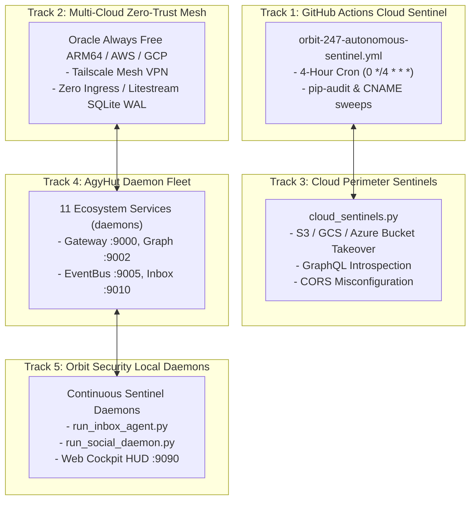

# 🛸 Orbit Security & AgyHut: Cloud Workers & Daemon Ecosystem Handoff

**Date:** 2026-11-01  
**Author:** Nova (`en-US-AvaNeural`) & Antigravity Systems Architect  
**Predecessor Session:** `b7754e76-776a-4e23-9497-67e881c2afec`  
**Primary Workspaces:** `A:\projects\orbit-security` & `A:\` (Physical: `C:\AgyHut`)  
**Git State:** `main` at commit `fecc9fe` (76/76 unit & integration tests green)  

---

## 1. Executive Context & Immediate Objectives

In the preceding session, we successfully architected, implemented, and verified the **Autonomous Inbox Triage & Guardrail Hardening** system on `main`. All 4 guardrail layers, the 3-tier triage bridge (Gemini CLI $\rightarrow$ Ollama $\rightarrow$ template fallback), and atomic state persistence are fully merged.

The user's directive for the next session is to **work on all cloud workers, sentinels, and daemon fleets across Orbit Security and the AgyHut ecosystem**.

This document organizes the 5 target tracks, current ground truth, file maps, and an executable playbook for the new conversation.



---

## 2. Fleet Inventory & Current Ground Truth

### Track 1: GitHub Actions Ephemeral Cloud Sentinel
- **Workflow File:** [`.github/workflows/orbit-247-autonomous-sentinel.yml`](file:///A:/projects/orbit-security/.github/workflows/orbit-247-autonomous-sentinel.yml)
- **Status:** Configured on cron `0 */4 * * *`.
- **Current Blocker:** Local branch `main` has 5 hardening commits (`be080b4..fecc9fe`) that have not yet been pushed to `origin/main` (`https://github.com/CmfH009/Orbit-Security.git`).
- **Target Actions:**
  1. Push `main` to `origin/main`.
  2. Verify GitHub Actions workflow run health and test execution in the cloud.
  3. Ensure repository secrets (`GEMINI_API_KEY`, alert webhooks) are active on GitHub.

### Track 2: Multi-Cloud Zero-Trust Mesh & Oracle Always Free Node
- **Infrastructure Specs:**
  - Config: [`infra/cloud_init_multi_cloud_matrix.yaml`](file:///A:/projects/orbit-security/infra/cloud_init_multi_cloud_matrix.yaml)
  - Oracle Spec: [`infra/cloud_init_oracle_free.yaml`](file:///A:/projects/orbit-security/infra/cloud_init_oracle_free.yaml)
  - Replication: [`infra/litestream.yml`](file:///A:/projects/orbit-security/infra/litestream.yml)
  - Zero-Trust Provisioner: [`infra/provision_zero_trust_node.sh`](file:///A:/projects/orbit-security/infra/provision_zero_trust_node.sh)
- **Status:** Provisioning manifests exist. Tailscale client is currently not installed/running on the local Windows workstation.
- **Target Actions:**
  1. Audit deployment status of Oracle Always Free / AWS Graviton instance.
  2. Test WireGuard/Tailscale connectivity between workstation and remote sentinel node.
  3. Verify Litestream continuous SQLite WAL replication for the Blackboard.

### Track 3: Cloud Perimeter & Misconfiguration Sentinels
- **Source Module:** [`src/orbit_security/cloud_sentinels.py`](file:///A:/projects/orbit-security/src/orbit_security/cloud_sentinels.py) (802 lines)
- **Sentinels:**
  - `CloudBucketTakeoverSentinel`: Identifies unallocated AWS S3, GCS, Azure Blob storage buckets referenced by DNS.
  - `GraphQLIntrospectionSentinel`: Probes for exposed production GraphQL schemas.
  - `CorsMisconfigurationSentinel`: Scans for permissive origin reflection (`Access-Control-Allow-Origin: *` with credentials).
- **Status:** 100% syntactically clean and importable.
- **Target Actions:**
  1. Add standalone test coverage under `tests/test_cloud_sentinels.py`.
  2. Wire `cloud_sentinels.py` into `bounty_rolling_daemon.py` or the scheduled cron runner to feed discovered cloud findings directly into the Blackboard WAL.

### Track 4: AgyHut Local Microservices & Daemons
- **Management CLI:** `daemons` (alias for `hut-daemon`), `health` (alias for `hut-health`)
- **Status:** All 11 ecosystem services are currently `STOPPED`:
  - `gateway` (Port 9000): AgyHub Unified API Gateway
  - `apis` (Port 9001): Public-APIs Service
  - `graph` (Port 9002): GraphRAG Knowledge Graph API (167k+ nodes in `C:\AgyHut\graphify-out`)
  - `scraper` (Port 9003): Stealth Scraper Archiver API
  - `eventbus` (Port 9005): Universal EventBus Signal Bridge
  - `notebook` (Port 9006): Google NotebookLM Bridge API
  - `hypernote` (Port 9007): HyperNote Multimodal Engine
  - `sidekick` (Port 9008): Gemma Local Sidekick Daemon
  - `inbox` (Port 9010): Task Inbox Supervisor
  - `companion` (Port 8765): Browser Companion Bridge
  - `streamproxy` (Port 8989): Multi-Adapter Streaming Proxy
- **Target Actions:**
  1. Evaluate which services are required for active development.
  2. Start core services (`gateway`, `graph`, `eventbus`) and verify port responsiveness.

### Track 5: Orbit Security Local Daemon Fleet & Web Cockpit HUD
- **Daemons:**
  - [`scripts/run_inbox_agent.py`](file:///A:/projects/orbit-security/scripts/run_inbox_agent.py): Autonomous IMAP Inbox & Deal Desk daemon (single-instance mutex `Global\OrbitSecurityInboxDaemon`).
  - [`scripts/run_social_daemon.py`](file:///A:/projects/orbit-security/scripts/run_social_daemon.py): X social agent & thought leadership daemon.
  - [`src/orbit_security/bounty_rolling_daemon.py`](file:///A:/projects/orbit-security/src/orbit_security/bounty_rolling_daemon.py): Bug bounty program tracker.
  - Web Cockpit HUD: Port 9090 telemetry monitor.
- **Status:** Hardened with newly merged 4-layer guardrails on `main`. Not currently running in background.
- **Target Actions:**
  1. Run a dry-run test of `run_inbox_agent.py --once` with live credentials.
  2. Launch Web Cockpit HUD on port 9090 and verify live Blackboard telemetry stream.

---

## 3. Fast-Start Playbook for the Next Agent

When opening the new conversation, execute this verification protocol immediately:

```powershell
# 1. Verify working directory and git status
cd A:\projects\orbit-security
git status
git log -n 3 --oneline

# 2. Run the 76-test suite to ensure zero drift
pytest tests/test_inbox_guardrail.py tests/test_inbox_triage_bridge.py tests/test_inbox_agent_autonomous_dispatch.py tests/test_inbox_agent.py tests/test_gemini_cli_bridge.py tests/test_triage_agent.py -v

# 3. Check AgyHut ecosystem daemon statuses
health
```

---

## 4. Ready-to-Use Prompt for the New Session

Copy and paste this prompt to kick off the new conversation:

```text
/boost Let's work on the Cloud Workers & Daemon Ecosystem for Orbit Security and AgyHut.

Please read the handoff file first:
A:\projects\orbit-security\HANDOFF_CLOUD_WORKERS_AND_DAEMON_ECOSYSTEM.md

We have 5 tracks ready to activate:
1. GitHub Actions Cloud Sentinel (push local main fecc9fe to origin and verify CI/cron runs)
2. Cloud Misconfiguration Sentinels (test and wire cloud_sentinels.py into active recon sweeps)
3. Multi-Cloud Zero-Trust Mesh & Tailscale (review Oracle/AWS cloud-init and Litestream WAL replication)
4. AgyHut Local Daemon Fleet (triage and start required services via 'daemons' / 'health')
5. Orbit Security Live Daemons & Cockpit HUD (test run_inbox_agent.py and boot Web Cockpit on :9090)

Let's start by verifying git and test status, and review Track 1 and Track 4.
```
