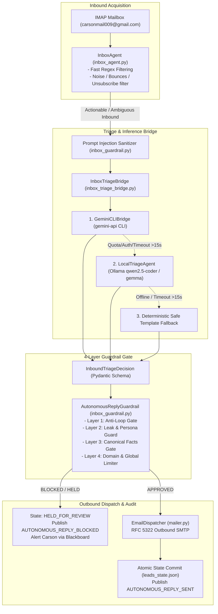

# Orbit Security: Autonomous Inbox Triage & Gemini Bridge Hardening Design Specification

**Document:** `2026-11-01-inbox-agent-gemini-bridge-hardening-design.md`  
**Date:** 2026-11-01  
**Author:** Antigravity Autonomous Systems Architect & Nova  
**Project:** Orbit Security (`A:\projects\orbit-security`)  
**Status:** VALIDATED DESIGN — READY FOR IMPLEMENTATION PLAN  

---

## 1. Executive Summary & Problem Context

Orbit Security's cold outreach engine previously dispatched 178 campaigns yielding a 24.2% bounce rate and multiple ambiguous or unparsed agency replies. The existing `InboxAgent` relies heavily on static keyword and regular expression matching (`classify_intent`). When prospect emails diverge from anticipated phrasing, the system classifies them as `UNCLEAR` and drops them without actionable follow-up or escalates them unproductively.

Furthermore, while the security scanner uses `LocalTriageAgent` (Ollama) and `GeminiCLIBridge` for CVE and exploit assessment, the commercial inbound pipeline has had zero access to this intelligence.

This specification designs a **hardened, production-grade autonomous triage and response pipeline** that wires `InboxAgent` into `GeminiCLIBridge` (with automatic failover to local Ollama and deterministic templates). It permits **fully autonomous outbound SMTP replies** governed by a **strict, non-negotiable 4-layer guardrail gate** that prevents email loops, prompt injection attacks, hallucinated pricing or SLAs, and unauthorized outbound bursts.

---

## 2. System Architecture & Component Responsibilities

The pipeline follows a decoupled, single-responsibility architecture:



### Component Breakdown:

1. **`InboxAgent` (`src/orbit_security/inbox_agent.py`)**:
   - Preserves 60-second polling cadence and mutex locking (`Global\OrbitSecurityInboxDaemon`).
   - Retains deterministic regex filters for known non-prospect noise (Google notifications, GitHub alerts, delivery status bounces, and direct unsubscribes).
   - Routes valid leads and `UNCLEAR` inquiries directly to `InboxTriageBridge`.
   - Records state updates and alerts atomically.

2. **`InboxTriageBridge` (`src/orbit_security/inbox_triage_bridge.py`)**:
   - Manages prompt composition, prospect context injection, and structured output parsing.
   - Orchestrates the 3-tier inference failover:
     - **Tier 1:** `GeminiCLIBridge` (subcommand `gemini-api` with zero cloud SDK imports).
     - **Tier 2:** `LocalTriageAgent` (local Ollama HTTP API with `keep_alive="0"` to conserve workstation RAM).
     - **Tier 3:** Deterministic template fallback ensuring zero unhandled crashes or uncommunicative drop-offs.
   - Enforces the `InboundTriageDecision` Pydantic contract.

3. **`AutonomousReplyGuardrail` (`src/orbit_security/inbox_guardrail.py`)**:
   - Pure standard library Python with zero external LLM dependencies.
   - Evaluates outbound decisions across 4 distinct integrity layers before releasing messages to SMTP.
   - Fails closed: any violation transitions the lead to `HELD_FOR_REVIEW` with an immutable reason code.

4. **`EmailDispatcher` (`src/orbit_security/mailer.py`)**:
   - Encodes and transmits approved responses over authenticated TLS/SMTP.
   - Sets appropriate RFC 5322 headers (`In-Reply-To`, `References`, `Message-ID`).

5. **`Blackboard` (`src/orbit_security/blackboard.py`)**:
   - SQLite WAL event log recording real-time telemetry (`INBOUND_LEAD_TRIAGED`, `AUTONOMOUS_REPLY_SENT`, `AUTONOMOUS_REPLY_BLOCKED`, `INBOX_ESCALATION_ALERT`).

---

## 3. Data Contracts & Pydantic Schemas

### 3.1 `InboundTriageDecision`

All LLM providers must return JSON conforming strictly to the following schema:

```python
from enum import Enum
from typing import Optional
from pydantic import BaseModel, Field

class TriageAction(str, Enum):
    AUTONOMOUS_REPLY = "AUTONOMOUS_REPLY"
    ESCALATE_TO_CARSON = "ESCALATE_TO_CARSON"
    ARCHIVE_NO_ACTION = "ARCHIVE_NO_ACTION"
    SUPPRESS_UNSUBSCRIBE = "SUPPRESS_UNSUBSCRIBE"

class InboundTriageDecision(BaseModel):
    """Schema-constrained classification and reply generation contract."""
    sender: str = Field(description="Normalized sender email address")
    subject: str = Field(description="Normalized subject line")
    intent: str = Field(description="READY_TO_BUY | REQUEST_HUMAN | INQUIRY_PRICING | INQUIRY_TECHNICAL | NOT_INTERESTED | UNCLEAR")
    confidence: float = Field(ge=0.0, le=1.0, description="Confidence score of classification")
    reasoning: str = Field(description="Concise 1-2 sentence justification for intent and response")
    recommended_action: TriageAction = Field(description="Recommended execution path")
    suggested_tier: Optional[str] = Field(None, description="monitoring | remediation | enterprise")
    portal_link_requested: bool = Field(False, description="Whether agency requested portal or pricing link")
    draft_reply_subject: Optional[str] = Field(None, description="Re: subject line for the reply")
    draft_reply_body: Optional[str] = Field(None, description="Complete, professional plain-text reply body")
    provider_resolved: str = Field("GEMINI_CLI", description="GEMINI_CLI | OLLAMA_LOCAL | DETERMINISTIC_FALLBACK")
```

### 3.2 Canonical Ground-Truth Constants

```python
CANONICAL_PRICING = {
    "monitoring": {
        "monthly": 499,
        "annual": 4990,
        "features": ["Continuous DNS radar", "DMARC/SPF monitor", "Subdomain takeover watcher", "Daily diffs"]
    },
    "remediation": {
        "monthly": 1499,
        "annual": 14990,
        "features": ["Active patching", "Direct DNS takeover mitigation", "DMARC alignment hands-on", "Monthly pentest audit"]
    },
    "enterprise": {
        "monthly": 4999,
        "features": ["Up to 25 agency client domains", "White-label client portals", "Dedicated Slack/email channel", "4-hour SLA"]
    }
}

CANONICAL_URLS = {
    "booking": "https://cal.com/orbit-security",
    "portal_root": "https://orbit-security.com/portals/",
    "sample_audit": "https://orbit-security.com/sample_audit.pdf"
}

FORBIDDEN_PROMISES = [
    "soc 2", "soc2", "iso 27001", "iso27001", "hardware", "on-premise install",
    "physical security", "guaranteed zero bugs", "pci-dss certification"
]
```

---

## 4. The 4-Layer Guardrail Gate

The `AutonomousReplyGuardrail.evaluate()` method executes sequentially:

### Layer 1: Anti-Loop & Thread State Gate
- **Condition 1 (Thread Count):** Checks `leads_state.json` / SQLite DB. If `auto_replies_count >= 1` for this recipient/thread without subsequent human message or manual reset, immediately block.
  - *Violation Code:* `ANTI_LOOP_DETECTED`
- **Condition 2 (RFC Header Check):** Inspects inbound email headers. If `Auto-Submitted` is present (not `no`), or `X-Autoreply`, `X-Autorespond`, or `Precedence: bulk|junk` is detected, or subject matches `(?i)^(automatic reply|out of office|undeliverable|delivery failure)`, block immediately.
  - *Violation Code:* `AUTO_RESPONDER_DETECTED`

### Layer 2: Leak & Persona Guard
- **Condition 1 (AI Meta-Language):** Inspects `draft_reply_body` for phrases like `"as an ai"`, `"language model"`, `"system prompt"`, `"gemini"`, `"ollama"`, or `"openai"`.
  - *Violation Code:* `AI_BOILERPLATE_LEAK`
- **Condition 2 (System Path Leak):** Inspects body for file system paths (`A:\`, `C:\`, `/home/`, `.py`, `.json`, `.wal`).
  - *Violation Code:* `SYSTEM_PATH_LEAK`
- **Condition 3 (Sign-off Integrity):** Ensures email concludes with an approved founder/operator signature (`Carson Haynes`, `Founder, Orbit Security`, or `Orbit Security Concierge`).

### Layer 3: Canonical Facts Gate
- **Condition 1 (Price Verification):** Uses regular expressions to extract any dollar amounts (`\$\d+(?:,\d+)?`) mentioned in `draft_reply_body`. Any amount not in `{499, 1499, 4999, 4990, 14990}` triggers an immediate block.
  - *Violation Code:* `UNAUTHORIZED_PRICE_DISCREPANCY`
- **Condition 2 (Scope Compliance):** Checks for terms in `FORBIDDEN_PROMISES`.
  - *Violation Code:* `UNAUTHORIZED_SCOPE_PROMISE`
- **Condition 3 (Link Whitelist):** All extracted hyperlinks (`https?://\S+`) must resolve to subdomains of `orbit-security.com` or `cal.com`.
  - *Violation Code:* `UNAUTHORIZED_EXTERNAL_LINK`

### Layer 4: Domain & Global Rate Limiting
- **Condition 1 (Domain Throttle):** A rolling 24-hour token bucket allows at most 1 automated outbound reply per root organization domain (e.g. `@nike.com`).
  - *Violation Code:* `DOMAIN_RATE_LIMIT_EXCEEDED`
- **Condition 2 (Global Burst Cap):** A rolling 60-minute token bucket permits at most 10 automated replies across all recipients globally.
  - *Violation Code:* `GLOBAL_BURST_CAP_EXCEEDED`
- **Condition 3 (Suppression List):** Rejects any address present in `data/bounced_agencies.json` or `VENDOR_AND_SYSTEM_DOMAINS`.
  - *Violation Code:* `SUPPRESSED_RECIPIENT`

---

## 5. Inference & Failover Pipeline

```python
class InboxTriageBridge:
    def __init__(self, gemini_bridge=None, ollama_url=None, timeout: float = 15.0):
        self.timeout = timeout
        self.gemini_bridge = gemini_bridge or GeminiCLIBridge()
        self.ollama_url = ollama_url or "http://127.0.0.1:11434/api/chat"

    def triage_inbound_message(self, sender: str, subject: str, body: str) -> InboundTriageDecision:
        # 1. Sanitize prospect input
        clean_body = PromptInjectionSanitizer.sanitize(body)

        # 2. Tier 1: Gemini CLI Subprocess
        try:
            decision = self._call_gemini_cli(sender, subject, clean_body, timeout=self.timeout)
            if decision:
                return decision
        except Exception as e:
            logger.warning(f"Tier 1 Gemini CLI bridge failed ({e}); falling back to Ollama")

        # 3. Tier 2: Local Ollama
        try:
            decision = self._call_local_ollama(sender, subject, clean_body, timeout=self.timeout)
            if decision:
                return decision
        except Exception as e:
            logger.warning(f"Tier 2 Local Ollama failed ({e}); falling back to deterministic template")

        # 4. Tier 3: Deterministic Safe Fallback
        return self._deterministic_fallback(sender, subject, clean_body)
```

- **Prompt Injection Sanitizer**:
  - Truncates body to 4,000 characters.
  - Escapes XML tags (`<system>`, `<prompt>`, `</context>`).
  - Redacts instruction overrides (`"ignore previous instructions"` $\rightarrow$ `[REDACTED_ADVERSARIAL_INPUT]`).
- **RAM Lifecycle**: When invoking Ollama, `keep_alive="0"` is set to ensure model weights unload immediately after inference, keeping workstation memory free.

---

## 6. State Persistence & Blackboard Telemetry

### 6.1 Atomic State Swaps
Updates to `data/leads_state.json` write to a temporary file in the same directory (`leads_state.json.tmp`) and perform an atomic `os.replace` to prevent file corruption during sudden system crashes.

### 6.2 Blackboard SQLite WAL Events
All transactions publish structured payloads:

```json
{
  "event_type": "AUTONOMOUS_REPLY_SENT",
  "payload": {
    "recipient": "cto@targetagency.com",
    "subject": "Re: Orbit Security Audit Follow-up",
    "intent": "INQUIRY_PRICING",
    "suggested_tier": "remediation",
    "provider": "GEMINI_CLI",
    "message_id": "<202611010415.abc@orbit-security.com>",
    "timestamp": 1793506527.12
  }
}
```

```json
{
  "event_type": "AUTONOMOUS_REPLY_BLOCKED",
  "payload": {
    "recipient": "rep@targetagency.com",
    "violation_layer": "LAYER_3_CANONICAL_FACTS",
    "violation_code": "UNAUTHORIZED_PRICE_DISCREPANCY",
    "reason": "Draft reply referenced price $250 which does not match canonical tiers",
    "action_taken": "HELD_FOR_REVIEW",
    "timestamp": 1793506527.12
  }
}
```

---

## 7. Empirical Test Matrix

The test suite enforces rigorous coverage before integration:

1. **`tests/test_inbox_guardrail.py`**:
   - `test_anti_loop_rejects_second_reply()`: Verifies a second automated reply in thread is rejected.
   - `test_auto_responder_headers_rejected()`: Verifies `Auto-Submitted` and out-of-office headers are blocked.
   - `test_ai_boilerplate_leak_detected()`: Verifies rejection of `"as an ai language model"`.
   - `test_unauthorized_pricing_rejected()`: Verifies amounts like `$199` or `$3,000` fail Layer 3.
   - `test_canonical_pricing_accepted()`: Verifies exact `$499`, `$1,499`, `$4,999` pass Layer 3.
   - `test_domain_rate_limiter_blocks_second_domain_email()`: Verifies 2nd email to same root domain in 24h is held.
   - `test_global_burst_cap_enforced()`: Verifies 11th email in 1 hour is held.

2. **`tests/test_inbox_triage_bridge.py`**:
   - `test_sanitizer_strips_prompt_injection()`: Proves adversarial directives are neutralized.
   - `test_gemini_cli_structured_parsing()`: Tests subprocess parsing against mock `gemini-api` JSON output.
   - `test_failover_to_ollama_on_cli_failure()`: Tests graceful handover to local Ollama on CLI error.
   - `test_failover_to_deterministic_fallback()`: Tests safe fallback when both LLMs are offline.

3. **`tests/test_inbox_agent_autonomous_dispatch.py`**:
   - End-to-end integration: Mock IMAP inbox poll $\rightarrow$ bridge $\rightarrow$ guardrail $\rightarrow$ mock SMTP delivery $\rightarrow$ atomic state file updated $\rightarrow$ SQLite WAL Blackboard event published.

---

## 8. Implementation Rollout Phases

1. **Phase 1: Guardrail Engine (`src/orbit_security/inbox_guardrail.py`)**:
   - Build `PromptInjectionSanitizer` and `AutonomousReplyGuardrail`.
   - Write and pass `tests/test_inbox_guardrail.py`.
2. **Phase 2: Triage Bridge (`src/orbit_security/inbox_triage_bridge.py`)**:
   - Implement `InboxTriageBridge` with 3-tier failover.
   - Write and pass `tests/test_inbox_triage_bridge.py`.
3. **Phase 3: Pipeline Integration (`src/orbit_security/inbox_agent.py`)**:
   - Wire `InboxTriageBridge` and `AutonomousReplyGuardrail` into `InboxAgent.process_inbound_lead()`.
   - Implement atomic state writes and Blackboard event publishing.
   - Write and pass `tests/test_inbox_agent_autonomous_dispatch.py`.
4. **Phase 4: Full Suite Regression Verification**:
   - Run complete test suite (`pytest tests/`) ensuring all existing tests pass alongside new hardening tests.
